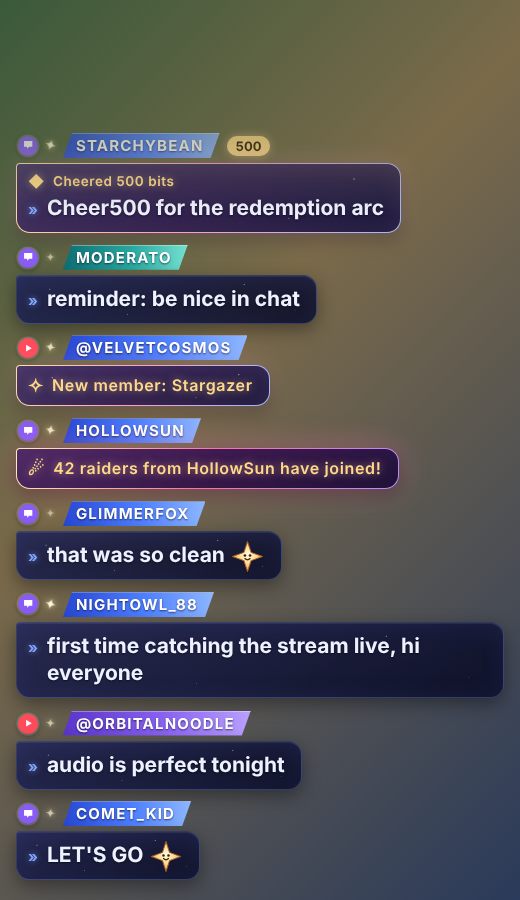

# Merged Chat for OBS (Twitch + YouTube)

*Version 1.8.0. The black window from `Start Chat.bat` prints the version on its first line.*

One chat box for your stream with **Twitch and YouTube together**, styled with a celestial look, and **no moderation buttons or panels** in the way. You keep moderating in the normal Twitch and YouTube windows. When your mods delete a message, time someone out or ban them on Twitch or YouTube, the overlay follows along (you choose how; see **Moderation and cleanup**).

Made for Kaneko Lumi's stream, and free for any streamer to use (MIT license). **Using it for your own channel:** in `config.toml`, put your Twitch name in `channel`, your names in `mention_names`, and make your own YouTube connection (step 3). Nothing else is tied to one channel.



*(The preview uses made-up demo messages and a stand-in font; in OBS it uses Lexend and Quicksand.)*

## What it does

- Twitch and YouTube chat in one feed, with a small icon showing where each message came from
- Twitch emotes and **7TV** emotes, plus your **YouTube member emojis** from your own image files
- Messages that **@mention you** (like `@kanekolumi` or `@Lumi`) get a gold rim so they don't get lost
- Highlighted lines for **subs, gift subs, bits, raids, Super Chats, Super Stickers and new members**
- A **separate support-events window**: put bits, Super Chats, subs and raids in their own spot on screen (they also stay in chat)
- Shows the newest 8 messages; the oldest one fades out at the top as new ones arrive
- Finds your YouTube stream on its own when you go live. No pasting links every stream.
- **Collabs (Twitch Shared Chat):** lines from the partner channel's chat get a small "collab" tag (or can be hidden), and their subs and raids never land in your events window
- Twitch **replies** show what they're answering ("replying to @name")
- Your dock shows **first-time chatters** (so you can say hi) and your **chat modes** (sub-only, slow, members-only...) while they're on
- Hides chat bots (Nightbot and friends) and `!commands` like `!catch` or `!discord`, so the overlay stays readable
- **Sub-only overlay** at the flip of a setting: on stream, only subs, YouTube members, VIPs and mods show. Your real chat stays open.
- Your own cleanup tools in the dock: **Hide** a line, **Hide user**, **Clear overlay**, a blocked-words list, and a **Settings** panel for all of it. They only change what viewers see on the overlay.
- Optional chat game, **Starcatch** (off unless you turn it on): a star drifts onto the screen and viewers on both platforms type `!catch`
- Read-only: it can't post, delete or ban anything on Twitch or YouTube. Twitch needs no login at all, and YouTube only gets read-only access.
- Runs on your PC only. Nothing is uploaded anywhere.

---

## What you need

- Windows 10 or 11
- OBS Studio
- **Python 3.11, 3.12 or 3.13** from [python.org](https://www.python.org/downloads/windows/). During install, tick **"Add python.exe to PATH"**. *(Not needed if you were given the app version with `chatmerge.exe`; see below.)*
- A Google account that manages your YouTube channel (only for the YouTube part)

---

## One-time setup (about 15 minutes)

### 1. Unzip it

1. Right-click the zip, choose **Properties**, tick **Unblock** at the bottom if you see it, then **OK**. (This stops Windows from blocking the launchers.)
2. Extract it somewhere permanent, for example your `Documents` folder. You'll get a folder called `chatmerge`; everything below happens inside it.

### 2. Run Setup

> **App version (has `chatmerge.exe`, no `Setup.bat`):** skip this step; nothing to install. The first time you double-click a launcher, Windows may say "Windows protected your PC" because the app isn't signed: click **More info**, then **Run anyway**.

Double-click **`Setup.bat`**. It makes a private Python environment inside the folder (it doesn't touch anything else on your PC), installs what it needs and runs a quick self-test. It takes a minute or two the first time.

If you only want Twitch chat, open `config.toml` in Notepad, set `enabled = false` under `[youtube]`, save, and skip to step 5.

### 3. Create your YouTube connection (one time)

YouTube requires every app that reads live chat to have its own "key". You make yours for free in Google Cloud. Use the Google account that owns or manages your channel.

1. Go to [console.cloud.google.com](https://console.cloud.google.com/) and accept the terms if asked.
2. Top bar: click the project picker, then **New project**. Name it anything (e.g. `stream chat`) and click **Create**. Make sure it's selected afterwards.
3. Open [YouTube Data API v3](https://console.cloud.google.com/apis/library/youtube.googleapis.com) and click **Enable**.
4. Open [Google Auth Platform](https://console.cloud.google.com/auth/overview) and click **Get started**:
   - App name: anything (e.g. `Stream Chat`). Support email: your email.
   - Audience: **External**.
   - Contact email: your email. Agree and **Create**.
5. Go to **Audience** in the left menu. Under **Test users**, click **Add users**, add the Google account you'll log in with, and **Save**.
6. Go to **Clients** in the left menu, click **Create client**:
   - Application type: **Desktop app**. Name: anything. Click **Create**.
   - Click **Download JSON**.
7. In the chatmerge folder, make a folder called **`secrets`**. Move the downloaded file into it and rename it to **`client_secret.json`**.

### 4. Log in to YouTube

Double-click **`YouTube Login.bat`**. Your browser opens:

1. Pick your Google account, then **the channel you stream on** if it asks.
2. You'll see **"Google hasn't verified this app"**. That's expected because the app is the one you just made yourself. Click **Continue** (or **Advanced**, then **Go to Stream Chat**).
3. Allow the read-only YouTube permission.

When the window says `Saved YouTube token`, you're done.

> **About the 7-day login:** while your Google app is in "Testing" mode, Google makes the login expire after 7 days. When that happens, just double-click `YouTube Login.bat` again. To stop it expiring, go to **Audience** in Google Auth Platform and click **Publish app**. You'll still see the "unverified app" warning when logging in, which is fine for an app only you use.

### 5. Add it to OBS

**On stream (overlay):**
1. Sources, **+**, **Browser**.
2. URL: `http://127.0.0.1:8787/`
3. Width `520`, Height `900` (resize to taste). The background is already transparent.
4. Position it where you like.

**Support events window (optional second source):**
1. Sources, **+**, **Browser**.
2. URL: `http://127.0.0.1:8787/events`
3. Width `560`, Height `760`. Transparent like the chat.
4. Opened in a normal browser, both pages show a dark preview background (and the events page says it's waiting until the first event). In OBS they're transparent.
5. It shows only bits, Super Chats, Super Stickers, subs, gifts, raids and new members: the newest 5, slightly bigger than chat, with a glow when each one arrives. They still appear in the chat overlay too.

**For yourself (a chat panel inside OBS, optional):**
1. **Docks** menu, **Custom Browser Docks**.
2. Name: `Chat`, URL: `http://127.0.0.1:8787/?dock=1`
3. This one has a dark background, keeps more messages, and shows a status line at the top (handy if something's not connecting).
4. Your controls live here (none of them touch Twitch or YouTube):
   - Hover a line: **Hide** takes that line off the stream. **Hide user** (click twice) hides everything from that name on both platforms, now and later. Undo it in Settings.
   - **Settings** (top right): sub-only overlay, bots, `!commands`, hidden users, blocked words, what happens when mods act. **Save** applies it instantly; no restart.
   - **Clear overlay** (click twice) empties the chat and events windows.
   - When the overlay is set to subs only, lines viewers can't see on stream are dimmed in your dock.
   - A green **FIRST MESSAGE** tag marks someone chatting in your Twitch channel for the first time. It only shows in your dock, like on Twitch where only mods see it.
   - Gold chips at the top show when your real chat is in a special mode: Twitch sub-only, emote-only, followers-only, slow or unique-chat, and YouTube members-only. YouTube only reports changes, so a members-only mode switched on before the app started won't show until it changes.

**Starcatch game (optional, only if you turned it on):** Sources, **+**, **Browser**, URL `http://127.0.0.1:8787/game`, Width `480`, Height `420`. See **Starcatch** below.

**To position the overlays without being live:** double-click **`Start Demo.bat`** and it plays fake messages (including fake bits, Super Chats and raids) into both windows on a loop. Close that window when you're done.

---

## Test it before you go live

You don't have to go live to check everything works:

- **Looks and OBS placement:** double-click **`Start Demo.bat`** (fake messages, no internet needed).
- **Real Twitch chat:** put any busy live channel in `config.toml` (`channel = "..."`) and run **`Start Chat.bat`**. You'll see real chat, emotes, subs, bits and raids from that channel. Put your own channel back afterwards.
- **Real YouTube chat:** double-click **`Test YouTube Stream.bat`**, then paste the link of any public YouTube live stream (open the stream, click **Share**, copy the link). It reads that stream's chat instead of yours, alongside your Twitch channel. Needs the YouTube login from step 4 first. Close it when done; the normal `Start Chat.bat` goes back to finding your own stream.

Tip for the first real stream: keep your old chat source in OBS, just hidden. If anything looks off, unhide the old one and hide the new one.

---

## Every stream

1. Double-click **`Start Chat.bat`** and keep that window open (minimizing is fine). Closing it stops the chat.
2. Go live as normal. Twitch chat shows right away; YouTube is picked up within about 30 seconds of the stream starting.
3. When you're done, close the window.

---

## Customizing

Add these to the end of either OBS URL (combine with `&`):

| Option | What it does | Example |
|---|---|---|
| `max` | How many messages show at once (default 8 for chat, 5 for events) | `http://127.0.0.1:8787/?max=6` |
| `scale` | Makes everything bigger or smaller (default 1 for chat, 1.15 for events) | `?scale=1.25` |
| `hide` | Seconds before each message fades out on its own (default: never) | `?hide=30` |

Examples: `http://127.0.0.1:8787/?max=6&scale=1.2` or `http://127.0.0.1:8787/events?hide=60`

**Colors:** open `chatmerge\web\overlay.css` in Notepad. All the colors are at the top in the `:root` section (name ribbons, bubble glass, the gold for events). Change the hex codes, save, then right-click the browser source in OBS and choose **Refresh**.

**Fonts:** the names use *Lexend* and messages use *Quicksand*, loaded from Google Fonts. You can change them in the same place.

**YouTube member emojis:** YouTube only sends the code (like `:_lumiHeart:`), never the picture. Put your emoji images in the **`emotes`** folder, named after the code without the colons (`_lumiHeart.png`). PNG, GIF, WEBP and JPG all work. Codes without a picture show as a small neat label instead of raw text. New files are picked up while it runs; refresh the OBS source to see them.

**Settings in the dock vs `config.toml`:** everything in the dock's Settings panel can also be set in `config.toml`. `config.toml` is the starting point; what you save in the dock goes into `settings.json` and wins. **Reset to config.toml** in the panel (click twice) goes back.

**Bots and commands:** `[filters]` in `config.toml`:
- `hide_known_bots = true` hides Nightbot, Fossabot, Moobot, Wizebot, Sery_Bot and Botisimo.
- `hide_tip_bots = false` keeps StreamElements, Streamlabs and SoundAlerts, because hiding them also hides their tip announcements.
- `hide_commands = true` hides lines starting with `!word`. Paid lines (bits, Super Chats) never count as commands. (Names on the hidden list stay hidden, paid or not.)
- `hide_users = ["someviewer"]` under `[display]` hides any other names (any capitalization, Twitch and YouTube).

**Collabs (Twitch Shared Chat):** when you share chat with other streamers, their chat flows into yours. `shared_chat` under `[filters]` (or **Collab chat** in the dock's Settings): `"label"` shows those lines with a small "collab" tag (default), `"hide"` leaves them out, `"show"` shows them with no tag. Their subs and raids show as plain lines (no gold glow) and never go in your events window. Twitch doesn't send the partner's channel name without a login, so the tag just says "collab".

**Replies:** `show_replies = true` adds a small "replying to @name: ..." line above Twitch replies. YouTube live chat has no replies.

**Sub-only overlay:** `overlay_audience = "subs"` (or **Shows** in the dock's Settings) shows only Twitch subs, YouTube members, VIPs, mods and you on stream, plus every support event. YouTube doesn't say who is a channel *subscriber*, only who is a *member*, so on YouTube it's members. This doesn't change your real chat; to actually put chat in sub-only or members-only mode, use the normal Twitch and YouTube chat settings.

**Twitch channel:** set in `config.toml` (`channel = "kanekolumi"`).

**YouTube daily allowance:** Google gives your project 10,000 free units a day (resets at midnight Pacific). YouTube closes the chat connection about every 11 seconds and each reconnect costs 5 units, so unpaced it lasts about 6 hours of streaming. `hours_per_day` in `config.toml` (default `8`) spaces reconnects so the allowance covers that many hours of YouTube chat per day:

| `hours_per_day` | YouTube messages arrive up to |
|---|---|
| 6 or less | right away |
| 8 (default) | about 4 seconds later |
| 12 | about 11 seconds later |

Nothing is lost while it waits; the next connection picks up every message. The dock's status line shows units used so far. Twitch has no limit.

**@mention highlight:** in `config.toml`, `mention_names = ["kanekolumi", "lumi"]` lists the names that trigger the gold highlight (any capitalization). It only matches the whole name after an `@`, so `@Lumi1` or `@lumi_fan` won't trigger it. The color is `--mention` at the top of `overlay.css`.

---

## Moderation and cleanup

Nothing here bans, times out or deletes anything on Twitch or YouTube. Keep doing that in the normal Twitch and YouTube windows. These settings only decide what the **overlay** shows. Change them in the dock's **Settings** panel (instant), or under `[moderation]` in `config.toml` (restart `Start Chat.bat` after).

**When a mod acts on Twitch or YouTube:**

| Setting | When it happens | Default |
|---|---|---|
| `on_delete` | One message is deleted | `"remove"` |
| `on_timeout` | Someone is timed out (all their lines) | `"remove"` |
| `on_ban` | Someone is banned (all their lines) | `"remove"` |
| `on_clear` | Twitch `/clear` (YouTube has no clear) | `"remove"` |

Each one can be:
- `"remove"`: the line disappears
- `"placeholder"`: the name stays and the text becomes *message removed* (change the words with `placeholder_text`)
- `"keep"`: the overlay doesn't change

`removal_style = "fade"` slides lines out smoothly; `"instant"` makes them vanish at once.

**Blocked words:** `blocked_words = ["spoiler", "some phrase"]` stops matching messages from ever showing. Whole words only, any capitalization, so `"ass"` won't block "class". `block_links = true` also hides any message with a link in it. With `exempt_mods = true` (default), messages from you and your mods are never blocked. A Super Chat or bits with a blocked word still shows its "Super Chat $10" line (they paid), just without the text.

**Your dock buttons:**
- **Hide** (hover a line): takes that one line off the overlay. `on_dock_hide` picks `"remove"` or `"placeholder"`.
- **Clear overlay** (top right): click once, it turns red and says *Click again to clear*; click again within 3 seconds to empty the chat and events windows. Always a full removal.

Good to know:
- Twitch deletes, timeouts, bans and `/clear` all come through. YouTube timeouts and bans come through; single deleted YouTube messages should too, but that hasn't been confirmed on a real stream yet.
- Bans don't link across platforms. Someone banned on Twitch can still show up from their YouTube account; ban them there too.
- If a mod acts after a line has already scrolled away, nothing visible changes.

---

## Starcatch (optional chat game)

Off by default. To try it: in `config.toml` set `enabled = true` under `[game]`, restart, and add the `/game` browser source (step 5).

- Every 7 to 15 minutes (change it under `[game]`) a star creature drifts onto the game source with a 60-second timer.
- Viewers type **`!catch`** in Twitch or YouTube chat. One throw per person per star. Common stars are easy, rare ones harder, legendary ones (about 1 in 20) much harder.
- Everyone who catches it is shown on the card. Catches are saved in `data\starcatch.db`, so they carry over between streams.
- **`!stars`** shows that viewer's totals on the game source ("12 caught, 5 of 11 kinds").
- **Spawn a star** in the dock sends one out right now.
- It never posts in chat, so there's no bot account to set up and it uses none of the YouTube allowance. `!catch` and `!stars` lines are hidden from the chat overlay (if `hide_commands` is on). Hidden users can't play.
- The 11 species and their constellation art are original to this app.

---

## What shows up highlighted

| Platform | Event |
|---|---|
| Twitch | New subs, resubs (with their message), gifted subs (one line per gift bomb, not one per recipient), bits, raids |
| YouTube | Super Chats, Super Stickers, new members, member milestones, gifted memberships, gifts |

Super Chats of about $10 and up get a red rim and glow; raids get it too. Bits look the same at any amount; the number shows in the gold pill.

**TTS isn't its own event.** Twitch and YouTube don't send "this was read by TTS" to chat. What you'll see depends on how your TTS works:
- **TTS from a channel-point reward:** the viewer's text shows as a normal chat line.
- **TTS from bits or Super Chats:** shows as the bits or Super Chat event above (in both windows).
- **TTS from tips (StreamElements, Streamlabs, Ko-fi and so on):** tips don't go through Twitch or YouTube chat, so they only show if a bot posts about them in chat, and then as that bot's normal chat line.

---

## Troubleshooting

| Problem | Fix |
|---|---|
| `Setup.bat` says Python wasn't found | Install Python from python.org with **Add python.exe to PATH** ticked, then run Setup again. |
| Windows says "Windows protected your PC" | Click **More info**, then **Run anyway**. Or unblock the zip first (step 1). |
| "YouTube login missing" | Do steps 3 and 4. Or turn YouTube off in `config.toml` to run Twitch only. |
| YouTube chat stopped after about a week | The login expired. Run `YouTube Login.bat` again (see the 7-day note in step 4). |
| YouTube chat doesn't appear | Check the status line in the dock. It needs your stream to be live on the channel you logged in with, and live chat turned on. |
| Overlay is blank in OBS | Make sure `Start Chat.bat` is running, then right-click the browser source and click **Refresh**. |
| "Address already in use" | Another app is using port 8787. Change `port` in `config.toml` and use the new number in the OBS URLs. |
| Something odd happened mid-stream | Look in the **`logs`** folder: `chatmerge.log` has what happened, with times. Send it along when asking for help (it contains chat names, so share it privately). |
| "Could not read settings.json" at startup | The dock's saved settings file got damaged. Rename `settings.json` (to keep it) and start again; you'll be back on `config.toml` settings. |
| 7TV emotes show as plain words | The 7TV list loads on startup and refreshes every 15 minutes. New emotes appear after that, or restart `Start Chat.bat`. |

---

## Recording chat for testing

**`Record Chat.bat`** works like `Start Chat.bat` but also saves the raw chat into the `recordings` folder. Playing it back later shows exactly what happened, which is the best way to test changes without going live:

```
.\run_chat.ps1 -Replay "recordings\chat_2026-10-30_20-00-00.jsonl" -Speed 4
```

In the app version (with `chatmerge.exe`), from the app folder:

```
.\chatmerge.exe replay "recordings\chat_2026-10-30_20-00-00.jsonl" --speed 4
```

Speed `4` plays four times faster; `0` plays it all at once. Recordings contain real viewers' names and messages: keep them private.

---

## Privacy and safety

- The **`secrets`** folder holds your YouTube login. **Never share or upload it**, and delete it before giving this folder to anyone else.
- `recordings`, `logs` and `data` hold viewers' names and messages. Keep them private too.
- The overlay only answers pages it served itself on `127.0.0.1`. Other websites open in your browser can't read chat or press the dock's buttons.
- To remove access at any time: [myaccount.google.com/permissions](https://myaccount.google.com/permissions), find your app, **Remove access**.
- The YouTube API is free, with a daily allowance per Google project (see **YouTube daily allowance** above).

---

*Unofficial fan-made tool, built by lowbudgetmisery. Free to use, change and share under the MIT license (see `LICENSE`). Not affiliated with Twitch, YouTube, Google, 7TV or Phase Connect.*
